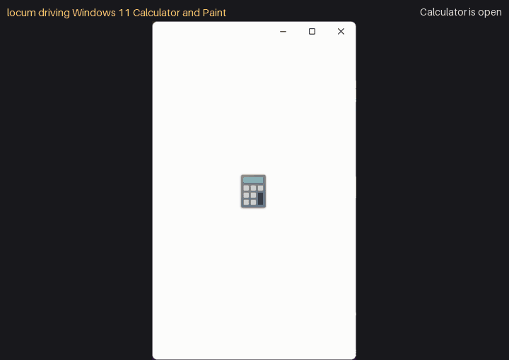

# locum

**Desktop automation for Python that understands the screen.** One library for
mouse/keyboard input, screenshots and template matching, accessibility
selectors, RPA robots, and LLM-agent control. Every push runs a real-desktop
self-test on Windows, macOS and Linux/X11, and a failure fails the build (see
below). Native Wayland support (through xdg-desktop-portal) is **experimental
and not yet validated on a real compositor**. Changes are in
[CHANGELOG.md](CHANGELOG.md); the stability promise is in [docs/API.md](docs/API.md).

| Platform | Backend | How it is tested today |
|----------|---------|------------------------|
| Windows 10/11 | SendInput + **UI Automation** | unit tests; **blocking** real-desktop self-test and focus-steal tests on the GitHub Windows runner on every push; validated on a real Windows 11 machine |
| macOS 12+ | Quartz events + **AX API** | unit tests; **blocking** real-desktop self-test on the GitHub macOS runner (Quartz, AX, TextEdit); passed on a real Apple Silicon Mac (0.1.1) |
| Linux (X11 / XWayland) | XTEST + **AT-SPI** | unit tests plus X11 tests under Xvfb; **blocking** self-test on Xvfb + openbox with a real D-Bus/AT-SPI registry and a GTK editor (not a full desktop session) |
| Linux (Wayland) | xdg-desktop-portal + **AT-SPI** | unit tests against a fake D-Bus portal only: **experimental, not yet validated on a real compositor**; opt-in only (`LOCUM_BACKEND=wayland`) |
| Java Swing/AWT (`locum.bridges.java`) | Java Access Bridge | **blocking** CI job driving a real Swing window through a Temurin JDK; **experimental** (one test window, no business application) |
| SAP GUI (`locum.bridges.sap`) | SAP GUI Scripting (COM) | unit tests against a fake COM object graph only: **experimental, never run against a real SAP GUI** |

* **Selectors, not coordinates.** `d.click('button "Save"')` finds the element
  through UI Automation / AX / AT-SPI, survives window moves, DPI and theme
  changes, and falls back to the native *invoke* action when the control is
  covered. UiPath-style XML selectors work too.
* **Vision when there is no accessibility tree.** FFT-based normalized
  cross-correlation, multi-scale, multi-monitor, **alpha channel = mask**, OCR
  hooks, wait-for-change / wait-until-stable.
* **Input that behaves like a person** (optional): Fitts's-law timing,
  Bézier mouse paths with overshoot, Unicode keystroke injection that does not
  depend on the keyboard layout (with read-back verification for text fields,
  see [below](#humanized-layout-independent-input)), clipboard paste,
  stuck-modifier-proof hotkeys, a corner fail-safe and a kill hotkey.
* **RPA built in.** Robots with steps/retries/evidence screenshots and HTML
  reports, resumable file-backed work queues with business exceptions that
  several worker processes on one machine can drain together (locked, leased,
  fsynced), YAML flows, and a recorder that writes selectors instead of raw
  coordinates.
* **LLM-native.** Set-of-marks observations; a Claude (Anthropic) agent loop
  and computer-use adapter; tool schemas exportable in Anthropic, OpenAI and
  MCP formats (locum ships no OpenAI agent runtime — bring your own loop);
  a zero-dependency MCP server; and a safety policy with human confirmation,
  dry-run and audit logs.
* **A drop-in PyAutoGUI layer** (`import locum.compat.pyautogui as pyautogui`)
  so existing scripts move over with one line.

> Status: **0.1 alpha** — usable, tested, but APIs may still change between
> releases. The design is in [`docs/ARCHITECTURE.md`](https://github.com/israerusan/locum/blob/main/docs/ARCHITECTURE.md).
> See [`docs/COMPARISON.md`](https://github.com/israerusan/locum/blob/main/docs/COMPARISON.md) and [`docs/LLM.md`](https://github.com/israerusan/locum/blob/main/docs/LLM.md).

---

## Install

```bash
pip install locum                 # core: pillow, numpy, mss (+ python-xlib / comtypes / pyobjc per OS)
pip install "locum[llm]"          # + anthropic SDK for the Agent
pip install "locum[ocr]"          # + pytesseract only (install the Tesseract binary too)
pip install "locum[record]"       # + pynput: live recorder and global kill hotkey
pip install "locum[yaml]"         # + PyYAML for YAML flows (JSON flows need nothing)
pip install "locum[all]"          # everything above
```

From a checkout: `pip install -e ".[dev]"` and `python -m pytest -q`. Tests that start a
real headless Edge/Chrome run on CI and with `LOCUM_TEST_BROWSER=1`; locally they are
skipped by default.

Platform notes: on **Linux** the clipboard works out of the box (native X11
selection handling; `xclip`/`xsel` are used if present) and, for
accessibility selectors, install PyGObject with AT-SPI (`python3-gi gir1.2-atspi-2.0`
on Debian/Ubuntu). On **macOS** grant your terminal/IDE *Accessibility* and
*Screen Recording* permission (System Settings → Privacy & Security).

## Check it on your machine

Before automating real work, run the self-test. It opens a fresh, empty
editor tab (Notepad / TextEdit / gedit), types into it, uses the clipboard and
moves that window, then cleans up and restores your clipboard and mouse. It
refuses to type into an editor that already contains text:

```bash
python -m locum.selftest          # report in ./locum_selftest_<timestamp>/
```

Don't touch the mouse or keyboard while it runs (about a minute); slam the
mouse into a screen corner to abort.

## 60-second quickstart

locum ships with a simulated desktop (an ERP form, a spreadsheet and a text
editor), so you can try everything without touching your real screen:

```python
from locum import Desktop
from locum.cli import DemoBackend

d = Desktop(DemoBackend())          # Desktop() drives your real screen instead

form = d.window("Invoice Entry*")   # exact title, substring, glob or regex
form.find("edit#vendor").set_text("ACME Corp")       # native set-value, falls back to typing;
                                                     # read back: refused/truncated input raises
form.find('edit "Invoice No"').set_text("INV-42")
form.find("edit#amount").set_text("1250.00")
d.click('button "Save"')                             # selector -> element -> click
print(d.find("text#status").text)                    # Saved invoice INV-42
```

The same from the shell (`--backend mock` = the demo desktop):

```bash
locum --backend mock windows
locum --backend mock tree --window "Invoice Entry"
locum --backend mock click 'button "Save"'
locum --backend mock observe                       # what an LLM agent sees
locum --backend mock run examples/excel_report_flow.yaml
```

On your real desktop the same calls work against real applications — e.g.
`locum inspect` prints a robust selector for the element under the mouse.

## Feature tour

The snippets below continue the quickstart (`d` is the demo desktop) and are
executed by the test-suite, so they stay correct.

### Selectors: CSS-like, UiPath XML or dicts

```python
d.find('window[name%="Invoice*"] button:has-text("save")')    # glob, case-insensitive text
d.find("<wnd app='erp' title='Invoice Entry*' /><ctrl automationid='amount' role='editable text' />")
d.find({"role": "button", "name": "Clear", "within": {"role": "window", "name": "Invoice Entry - ERP"}})
d.find('window "Book1 - Excel" > edit "Name Box"')             # child combinator
d.find('window "Invoice Entry - ERP" text "Amount:" + edit')   # adjacent sibling: the edit right after the label
d.find('checkbox "Urgent" ~ button "Submit Payment"')           # general sibling: any later sibling
cells = d.find_all('edit[name~="^[A-E]1$"]')                    # regex attribute match
assert [c.name for c in cells] == ["A1", "B1", "C1", "D1", "E1"]

from locum import selector_for
el = d.element_at(370, 171)                                     # what is under this point?
print(selector_for(el.node, roots=d.roots()))                   # window "Invoice Entry - ERP" edit#amount
print(d.tree(window="Invoice Entry*", interactive_only=True))   # readable tree dump
```

Combinators: descendant (space), child `>`, adjacent sibling `+`, general
sibling `~` (same parent, accessibility-tree order; top-level windows have no
siblings). Operators: `=` `!=` `*=` `^=` `$=` `~=` (regex) `%=` (glob), `i` flag for
case-insensitive; pseudo-classes `:enabled :visible :focused :checked :unchecked :mixed
:has-text() :has() :not() :nth() :first :last`. Every lookup waits up to
`default_timeout` and failures say what *was* there:
`No element matching 'button "Sav"'; did you mean: button "Save" #save`.

### Elements and windows

```python
amount = d.find("edit#amount")
amount.set_text("99.90").press("tab")                # actions chain
d.find("checkbox#urgent").check()
assert d.find("checkbox#urgent").is_checked
d.wait('button "Save"', state="enabled", timeout=5)

excel = d.window("Book1*")
excel.activate()
print(excel.rect, excel.app, excel.is_active)
d.window("Invoice Entry*").activate()

img = excel.screenshot()                        # its own content, even when other windows cover it
img = excel.screenshot(restore_minimized=True)  # minimized: shown without focus, captured, re-minimized
```

`Window.screenshot()` captures from the window itself (PrintWindow on Windows,
CGWindowListCreateImage on macOS, Composite on X11 with a compositing manager)
when the window is covered or off-screen, and grabs the screen otherwise.
`mode="screen"` or `mode="window"` forces one. CLI: `locum screenshot --window
"Invoice*" -o inv.png`.

### SAP GUI, Java and Citrix

UI Automation can't see inside SAP GUI, Swing apps or remote sessions, so
locum ships bridges ([docs/BRIDGES.md](docs/BRIDGES.md)). They are tested
against fakes of the COM/DLL APIs; real SAP GUI and JVM runs are still to come.

<!-- norun -->
```python
from locum.bridges import sap                       # pip install locum[sap]
s = sap.attach(system="PRD", client="100")
s.start_transaction("SE16N")
s.find("wnd[0]/usr/ctxtGD-TAB").text = "T001"
s.send_vkey(0)
s.check_status()                                    # raises SapError on an error message

from locum.bridges.java import JavaBridge           # jabswitch -enable, then restart the app
with JavaBridge() as jab:
    jab.window("Order Entry*").find('button "Save"').click()

from locum.bridges.remote import ImageSession       # Citrix / RDP: pixels + OCR, bound to the window
ImageSession(d.window(app="wfica32")).click_text("Purchase Orders")
```

Every bridge action goes through the same `Policy` as the rest of locum.

### Vision: template matching with alpha masks

```python
needle = d.screenshot((180, 268, 100, 32))           # a crop of the Save button
match = d.locate(needle, confidence=0.95)
print(match.rect, round(match.confidence, 3))         # Rect(left=180, top=268, ...) 1.0

masked = needle.convert("RGBA")
masked.paste((255, 0, 255, 0), (0, 0, 100, 8))         # transparent pixels are ignored when matching
assert d.locate(masked, region=(0, 0, 700, 600)).center == match.center
d.click_image(needle, timeout=2)                      # wait for it, then click its center
```

`locate_all` (non-max suppression), `scales=(0.8, 1.0, 1.25)` for DPI
differences, `grayscale=True`, `region=`, `d.wait_until_stable()` and
`d.wait_for_change()` are all there. With an OCR engine installed,
`d.find_text("Total")`, `d.click_text("Submit")` and `d.read_text(region)` work
on any pixels. `locum[ocr]` installs only `pytesseract` (plus the Tesseract
binary from your OS); RapidOCR (`pip install rapidocr-onnxruntime`) and EasyOCR
(`pip install easyocr`) are optional, separate installs that locum picks up
when present.

### Humanized, layout-independent input

```python
d.move('button "Clear"', humanize=True, duration=0.2)    # Bezier path with jitter and overshoot
d.click("edit#vendor")
d.type("Café Zoë ✓")                                     # Unicode injection, no keymap needed
d.hotkey("mod+a")                                        # ctrl+a, or cmd+a on macOS
d.press("backspace")
with d.hold("shift"):
    d.press("tab")
```

How reliable is typing? `d.type()` injects Unicode keystrokes (no keymap
lookup, so the keyboard layout does not matter), paced per character. That
does not make it infallible: some applications drop or garble synthesized
keystrokes while busy — seen intermittently with Windows 11 Notepad. For text
fields, `d.find("edit#vendor").type("…")` (`Element.type`, `verify=True` by
default) reads the field back afterwards and repairs a garbled result, or
raises instead of reporting success; `set_text()` sets the value natively and
verifies it; `d.type(text, mode="clipboard")` pastes instead of typing. Use one
of those when the exact text matters.

**Financial fields: say how strict.** `set_text`/`type` take `verify=`:
`True` (normalised: case, white space and unambiguous number formatting such as
`1250` → `1,250.00`), `"exact"` (character for character — document numbers,
vendor ids: `0001234` is not `1234`) or `"amount"` (both sides parsed with *one*
decimal separator, `decimal="."`/`","` or `Desktop(decimal_separator=...)`,
compared as `Decimal`; SAP's `1.250,00-` is understood). A read-back that reads
as a different number per locale — `1,000` is 1000 or 1.000 — never passes as a
number without a known separator. A field that cannot be read back (no value,
a password) is never reported as verified: `el.last_verification.status` is
`"unverified"`, and the strict modes raise `VerificationUnavailable` instead.

**One input owner at a time.** Every mouse/keyboard action — and a whole
`Element` action such as focus → select all → type → read back — holds the
desktop input lock, shared by all locum processes of your session. Workers can
process in parallel (native set-value/invoke need no lock) but never interleave
their input; `with locum.desktop_input(d):` holds it around a sequence of your
own, `locum.try_desktop_input(d)` takes it only if free (for an idle "keep
awake" nudger), and a wait beyond `Desktop(input_lock_timeout=30)` raises
`DesktopBusy` naming the holder.

`Desktop(humanize=True)` (or `Humanize(speed=..., jitter=..., seed=...)`) makes
every move human-like; `pause=` mirrors PyAutoGUI's `PAUSE`. Moving the mouse
into a screen corner raises `FailSafeTriggered`; `locum.install_kill_hotkey()`
(needs `pynput`) aborts from anywhere.

### RPA: robots, work queues, flows, recorder

```python
import re
from locum import FailSafeTriggered
from locum.rpa import BusinessException, Robot, WorkQueue

robot = Robot(d, name="invoices", run_dir="locum_runs")
queue = WorkQueue("invoices", path="locum_runs/invoices.queue.json")   # persistent: runs resume
queue.add({"vendor": "Initech", "invoice_no": "INV-43", "amount": "75"}, reference="Initech|INV-43")
queue.add({"vendor": "Umbrella", "invoice_no": "INV-44", "amount": "-1"}, reference="Umbrella|INV-44")

def enter_invoice(item):
    if not re.fullmatch(r"\d+(\.\d{1,2})?", item["amount"]) or float(item["amount"]) <= 0:
        raise BusinessException(f"invalid amount {item['amount']!r}")   # recorded, never retried
    d.click('button "Clear"')                               # known state: status "Cleared"
    d.find("edit#vendor").set_text(item["vendor"])          # errors up to here are retried
    d.find("edit#invoice_no").set_text(item["invoice_no"], verify="exact")
    d.find("edit#amount").set_text(item["amount"], verify="amount", decimal=".")

    def answered():                                         # the old status is still on screen
        status = d.find("text#status").text
        return status if status not in ("", "Cleared") else None

    d.click('button "Save"')
    try:                                                    # after Save, a retry could post twice
        status = d.wait_until(answered, timeout=10)
    except FailSafeTriggered:
        raise                                               # the operator stopped the robot
    except Exception as exc:
        raise BusinessException(f"needs review: no answer after Save ({exc})") from exc
    if status.lower().startswith("error"):
        raise BusinessException(status)                     # rejected by the app: never "success"
    return {"status": status}

@robot.task(retries=1)
def process():
    with robot.step("enter invoices"):
        robot.vars["stats"] = queue.process(enter_invoice, retries=2)

report = robot.run()          # timings, logs, error screenshots, report.json + report.html
print(report.summary(), robot.vars["stats"]["success"], robot.vars["stats"]["business_exception"])
```

Keep the **live** queue file on a local disk (`locum.rpa.default_queue_dir()`
is `%LOCALAPPDATA%\locum\queues` on Windows): a `WorkQueue` path inside
OneDrive, Dropbox, Google Drive, iCloud or a network share is refused
(`allow_synced=True` overrides), because a sync client replaces and locks files
behind the queue's file lock and atomic rename. Workers on several machines
sharing one queue file are not supported. Copy finished state into a synced
vault with `queue.export(path)` (and `report.save_json/save_html(path)`).

Declarative flows (YAML/JSON) cover the same ground without Python —
`click, type, set_text, wait, if_exists, for_each (csv/json/items), try/catch,
repeat, call, read_value, assert_exists, ...` with `${var}` interpolation; see
[`examples/excel_report_flow.yaml`](https://github.com/israerusan/locum/blob/main/examples/excel_report_flow.yaml):

```python
from locum.rpa import run_flow

report = run_flow({"steps": [
    {"set_text": {"target": "edit#vendor", "text": "${vendor}"}},
    {"assert_exists": {"target": "edit#vendor", "equals": "Hooli"}},
]}, d, variables={"vendor": "Hooli"})
assert report.ok
```

The `Recorder` turns live input (or anything locum itself does) into flows
or Python **with selectors instead of coordinates**:

```python
from locum.rpa import Recorder

rec = Recorder(d).start(source="backend")       # "auto" = global hooks via pynput
d.click("edit#due_date")
d.type("2026-12-31")
rec.stop()
print(rec.to_python())                          # d.click('window "Invoice Entry - ERP" edit#due_date') ...
```

### LLM control: tools, computer use, MCP, agents

```python
from locum.llm import DesktopToolkit, Policy

kit = DesktopToolkit(d, policy=Policy())        # every call is policy-checked and audited
tools = kit.to_anthropic()                      # also .to_openai() / .to_mcp()
obs = kit.call("observe", {"include_screenshot": False})
print(obs.text.splitlines()[-1])                # [N] ... numbered elements (set-of-marks)
print(kit.call("set_value", {"selector": "edit#vendor", "value": "Pied Piper"}).text)
print(kit.call("click", {"selector": 'button "Submit Payment"'}).is_error)   # True: needs confirmation
```

<!-- norun -->
```python
from locum import Desktop
from locum.llm import Agent, AuditLog, Policy, console_confirm

agent = Agent(Desktop(), policy=Policy(confirm=console_confirm), audit=AuditLog("audit.jsonl"))
result = agent.run("Open the Q3 report in Excel and e-mail the totals to Dana")
print(result.success, result.final_text)
```

* `mode="tools"` (default) gives Claude the toolkit above: element ids,
  selectors, OCR, keyboard/mouse, windows, apps, clipboard, and a `done` tool.
* `mode="computer_use"` uses Claude's computer-use toolset, executed by
  `ComputerUseAdapter` (screenshot scaling and coordinate mapping included).
* `locum mcp` exposes the same tools to Claude Desktop, Claude Code or any
  MCP client — config in [`examples/mcp_config.json`](https://github.com/israerusan/locum/blob/main/examples/mcp_config.json):

```json
{"mcpServers": {"locum": {"command": "locum", "args": ["mcp", "--policy", "default"]}}}
```

or `claude mcp add locum -- locum mcp --policy default` for Claude Code
(`locum-mcp` and `python -m locum.mcp` start the same server). Setup for
Claude Code / Claude Desktop, options and timeouts:
[`docs/MCP.md`](https://github.com/israerusan/locum/blob/main/docs/MCP.md).
Prompting tips and the safety model: [`docs/LLM.md`](https://github.com/israerusan/locum/blob/main/docs/LLM.md).

Web pages in Edge / Chrome are read and driven over the DevTools protocol
(`browser_launch`, `browser_observe`, `browser_click`, `browser_type`, ... or
`locum.browser.Browser` in Python), with a separate locum-managed browser
profile, instead of the browser's huge accessibility tree. After an action,
`observe(changes_only=true)` returns only what changed, with a cropped
screenshot.

### Safety policy

```python
from locum.llm import CARD_NUMBER, Policy

policy = Policy(
    allowed_apps=["erp", "excel"],              # act (and launch) only inside these apps
    deny_text_patterns=[CARD_NUMBER],           # never type card numbers (Luhn-checked; IBANs pass)
    confirm=lambda description, details: input(f"Allow {description}? [y/N] ") == "y",
    max_actions=200, max_actions_per_minute=30,
    region=(0, 0, 1920, 1080),                  # pointer must stay in this rectangle
    dry_run=False,                              # True: describe instead of act
)
strict = Policy.strict()                        # no launching/clipboard, shells blocked, broad confirmations
authorized = Policy.strict(allow=[              # default-deny: only these run without a human
    'window "Invoice Entry - ERP" edit',
    'window "Invoice Entry - ERP" button "Save"',
])
```

The default policy is a **heuristic tripwire**, not authorization. A human
`confirm` is needed (and without a callback the action is **blocked**) when the
target looks like a commit — *pay, transfer, wire, submit, send, delete, approve,
post, purchase, release, …* in English, German, French, Spanish, Portuguese,
Italian and Dutch, accents ignored (*Buchen*, *Überweisen*, *Supprimer*,
*Eliminar*, *Verwijderen*) — when Ctrl/Cmd+Enter or Ctrl/Cmd+S is pressed, or when a click,
Enter or field entry reaches a control that cannot be identified (nothing under
the pointer, or no name, automation id, value or named child: an icon-only
button). Keyword matching misses other languages, "Continue"/"Apply"-style
commits and shortcuts it was not told about.

For money and data actions use **allow-list mode**: with `Policy(allow=[...])` /
`Policy.strict(allow=[...])` every consequential action (clicks, text entry,
invoke, launching, clipboard writes, non-navigation keys) needs a human unless one
of your rules — a selector, `"window=..."`, `"app=..."`, `"launch=..."`,
`"keys=..."` or `"tool=..."` — matches what really receives it: the control the
mouse actually presses (not the container around it), or the default button that
Enter presses. A rule without `keys=` covers only typing, editing and navigation
keys and Enter/Space on the control it names; application shortcuts such as
Escape, F-keys or Alt+F4 need a `keys=` rule.

**Robots, flows and `locum run` are gated by default** with `Policy.default()`
(since 0.3). They run unattended, so a flagged action is **blocked**, not asked
about, and the error says how to allow it:

```python
from locum.llm import Policy
from locum.rpa import Robot

robot = Robot(policy=Policy.default(exempt=['button "Delete row"']))  # let this target through
robot = Robot(confirm=lambda what, details: input(f"{what}? ") == "y")  # or ask a human
robot = Robot(policy=Policy.off())                                        # or opt out, explicitly
```

A flow declares the commits it intends with a top-level `exempt:` list
(`- {window: "*Excel*", keys: "mod+s"}`). On the CLI, `locum run flow.yaml
--exempt 'button "Delete row"'`, `--confirm` and `--no-policy` do the same. Text typed into password fields is masked in audit
logs and recordings. Details: [`docs/LLM.md`](https://github.com/israerusan/locum/blob/main/docs/LLM.md#6-safety-model).

### Credentials

<!-- norun -->
```python
from locum.rpa.credentials import get_credential
cred = get_credential("erp")            # stored with: locum credential set erp --username robot01
d.find('edit "User"').set_text(cred.username)
d.find('edit "Password"').type(cred.password)   # a Secret: typed, but *** in traces, logs and reports
```

In a flow: `- type: {text: "${credential:erp.password}", into: 'edit "Password"'}`.
Windows uses Credential Manager; macOS/Linux need `pip install locum[credentials]`.

### PyAutoGUI compatibility

<!-- norun -->
```python
import locum.compat.pyautogui as pyautogui    # was: import pyautogui

pyautogui.moveTo(100, 200, duration=0.5, tween=pyautogui.easeInOutQuad)
pyautogui.write("Hello!\n", interval=0.05)
box = pyautogui.locateOnScreen("button.png", confidence=0.9)
pyautogui.click(pyautogui.center(box))
```

See [`examples/pyautogui_migration.py`](https://github.com/israerusan/locum/blob/main/examples/pyautogui_migration.py) for
the before/after.

## How it compares

|                                   | PyAutoGUI | UiPath | **locum** |
|-----------------------------------|:---------:|:------:|:-----------:|
| Mouse/keyboard/screenshots        | ✓ | ✓ | ✓ |
| Accessibility selectors (UIA/AX/AT-SPI) | — | ✓ (Windows-first) | ✓ |
| UiPath-style XML selectors        | — | ✓ | ✓ (compatible subset) |
| Template matching w/ alpha masks, multi-scale | confidence needs OpenCV | ✓ | ✓ (numpy; OpenCV optional) |
| OCR                               | — | ✓ | pluggable: Tesseract via `locum[ocr]`; RapidOCR / EasyOCR as separate installs |
| Native invoke / set-value (works when covered) | — | ✓ | ✓ |
| Humanized motion, Unicode typing  | partial | — | ✓ |
| Robots, retries, evidence reports | — | ✓ | ✓ (code-first) |
| Transaction queues                | — | ✓ (Orchestrator: central, multi-machine) | ✓ (local JSON file: resumable, multi-process on one machine, leases; no network shares or multi-machine) |
| Recorder                          | — | ✓ (Studio) | ✓ (emits Python/YAML with selectors) |
| Visual designer, Orchestrator, enterprise governance, support | — | ✓ | — |
| LLM tools, MCP server, computer-use adapter, agent loop | — | add-ons | ✓ built in |
| Price / license                   | free, BSD-3 | commercial (free Community tier) | free, MIT |

UiPath is a full enterprise platform — Studio's visual designer, Orchestrator
scheduling and credential vaults, Action Center, governance and vendor
support. locum does not replace that; it is a **code-first, free,
LLM-native** library for developers who want UiPath-grade robustness inside
plain Python. Full write-up: [`docs/COMPARISON.md`](https://github.com/israerusan/locum/blob/main/docs/COMPARISON.md).

## Platform details

How each platform is tested is in the table at the top; this is what each
backend uses.

| Platform | Input | Screenshots | Windows | Accessibility | Notes |
|----------|-------|-------------|---------|---------------|-------|
| Windows 10/11 | SendInput (Unicode, DPI-aware, multi-monitor) | mss / GDI | Win32 | **UI Automation** (comtypes) | run as the same integrity level as the target app (UAC); text locum puts on the clipboard is kept out of Clipboard History (Win+V) and cloud sync (`WindowsBackend(clipboard_history=True)` allows it) |
| macOS 12+ | Quartz events | Quartz (Retina-aware) | Quartz / AppKit | **AX API** | needs Accessibility + Screen Recording permission |
| Linux X11 | XTEST (Unicode via spare keycodes) | mss / XGetImage | EWMH | **AT-SPI** (PyGObject) | native X11 clipboard (xclip/xsel optional) |
| Linux Wayland (experimental) | RemoteDesktop portal (keysyms on the active layout; absolute pointer per ScreenCast stream) | Screenshot portal (slow; may prompt) | list only (AT-SPI): no activate/move/close | **AT-SPI** (element bounds hidden by default) | `pip install locum[wayland]`, `LOCUM_BACKEND=wayland`; GNOME/KDE portals; not yet validated on a real compositor |
| Any (tests, CI, evals) | `MockBackend` / `DemoBackend` | ✓ | ✓ | ✓ | deterministic, no display |

**Wayland (experimental):** Wayland deliberately prevents applications from
injecting input into, or capturing, other applications. The sanctioned route
is xdg-desktop-portal. With `pip install locum[wayland]` and
`LOCUM_BACKEND=wayland`, locum uses three portal channels:
RemoteDesktop + ScreenCast for keyboard and pointer (the compositor asks for
approval once; the restore token is kept in
`$XDG_STATE_HOME/locum/wayland-portal.json`), the Screenshot portal for capture
(it may ask for permission and is much slower than X11), and AT-SPI for
windows and elements. It has never been run on a real GNOME or KDE session,
so it is never picked automatically: only `LOCUM_BACKEND=wayland` selects it,
and it emits an `ExperimentalWarning`. Every Linux session, Wayland included,
gets the tested `x11` backend, which reaches XWayland clients.

What Wayland does not allow is refused, not faked:

* windows cannot be activated, moved, resized or closed;
* window positions and stacking order are unknown, so input bound to a window
  is refused when its destination cannot be verified;
* element bounds are hidden by default, because toolkits report
  window-relative extents, so elements are driven with native actions;
* there is no reliable emergency stop: the corner fail-safe cannot see you
  move the mouse, and the kill hotkey (pynput, X11) only sees keys while an
  XWayland window has focus (`install_kill_hotkey()` warns about this). Stop a
  run with Ctrl+C in its terminal, `locum.abort()`, or by ending the screen
  sharing in the compositor (its remote-desktop indicator), which closes the
  portal session;
* on GNOME every screenshot may flash the screen, and the portal writes it to a
  file (usually `~/Pictures/Screenshots`); locum deletes that file after
  reading it, but only a file in the Pictures or temporary directory written by
  that request (`keep_screenshots=True` keeps them);
* pointer positions are converted to each monitor's scale (GNOME with
  fractional scaling reads them in physical pixels); when the scale cannot be
  determined, absolute moves are refused rather than misplaced;
* typing is limited to characters on the active keyboard layout; others are
  pasted when wl-clipboard is installed.

GNOME and KDE implement the needed portals. xdg-desktop-portal-wlr (Sway and
other wlroots compositors) has no RemoteDesktop, so only screenshots work
there. `locum info` lists these limitations. For full-desktop automation, an
X11 session ("GNOME on Xorg") remains the tested path.

## Safety notes for LLM control

* An agent with desktop access can do anything **you** can: send e-mail, move
  money, delete files. Run unattended agents in a VM or a dedicated user
  account, never on a machine with privileged sessions open.
* Keep the default policy (or `Policy.strict()`): consequential actions need
  a human `confirm`; without one they are blocked. Use `allowed_apps` to fence
  the agent into the applications the task needs, and `dry_run=True` to
  rehearse.
* Keep the fail-safe on (mouse to a corner aborts) and arm the kill hotkey
  (`locum --kill-hotkey agent ...` or `install_kill_hotkey()`).
* Treat on-screen text as untrusted: a web page or document can contain
  instructions aimed at the model (prompt injection). The policy enforces
  limits regardless of what the model was told.
* Keep the audit log (`AuditLog(path)` / `--audit FILE`): every tool call, its
  arguments, the policy decision and the result are recorded as JSON lines.

## CLI

```text
locum [--backend NAME] [--timeout S] [--json] [--no-failsafe] [--humanize] [--kill-hotkey] COMMAND
  info | screenshot [-o PNG] [--region L,T,W,H] [--monitor N] | windows | tree [--window T] [--depth N] [--all]
  find SELECTOR [--all] | click TARGET [--window T | --anywhere] | move TARGET
  type TEXT [-e] (--into SEL | --window T | --focused) | hotkey COMBO (--window T | --focused)
  press KEY... (--window T | --focused) | scroll DY [--at TARGET] | wait SELECTOR [--state S]
  locate IMAGE [--confidence C] [--click --anywhere] | observe [--json] [--window T] [--screenshot PNG] | inspect [X,Y]
  mcp [--policy strict|default|permissive] [--dry-run] [--audit FILE]
  agent TASK [--model M] [--max-steps N] [--dry-run] [--mode tools|computer_use] [--replay FILE]
  run FLOW.yaml [--var k=v] [--report-dir DIR] [--validate] | record [-o out.py|out.yaml] [--duration S]
```

Exit codes: 0 ok · 1 failed (not found, timeout, policy, failed flow/agent, target lost) ·
2 usage/invalid input · 3 unavailable (backend, capability, missing extra) ·
4 fail-safe abort · 130 interrupted.

**Input goes to a named target.** Keystrokes go wherever the focus is, and a click
lands on whatever window is at the point. So `type`, `press` and `hotkey` need
`--window TITLE` (or `--into SELECTOR` for `type`), and a click on coordinates or
an image needs `--window TITLE`. The window is brought to the front, and every
key press, typed text chunk and click is checked against it right before it is
sent: if another window takes the focus (a chat, a notification, another app's
dialog) or covers the click point, nothing more is sent and the command exits
with 1 (`TargetLost`). `--focused` / `--anywhere` send to whatever has the focus
or is under the point now, and still stop if another window takes the focus
while typing. Selectors (`click 'button "Save"'`, `--into`) are always bound to
their element's window. Library calls work the same way: `Element.type`,
`click`, `press` and `set_text` are bound to the element's window and focus,
and the LLM tools bind each input to the window the policy judged.
`Desktop.type()` without an element goes to the focus, as documented.

**`--json` is a contract.** stdout carries exactly one JSON document, also on
failure (`{"ok": false, "error": {"type", "message", "exit_code"}}`); diagnostics
go to stderr; the exit code is non-zero on failure. Non-ASCII text is escaped
(`\u280b`) unless stdout is UTF-8, and text output never fails on a legacy
console code page (characters it cannot show become `?`).

`observe --window T` shows that window only: no other window's title, and the
parts of it covered by other windows are blanked out of the screenshot.

## Examples

| File | What it shows |
|------|---------------|
| [`basic_automation.py`](https://github.com/israerusan/locum/blob/main/examples/basic_automation.py) | windows, selectors, typing, screenshots, template matching |
| [`sap_style_data_entry.py`](https://github.com/israerusan/locum/blob/main/examples/sap_style_data_entry.py) | robot + CSV work queue entering invoices via selectors, business exceptions, reports |
| [`excel_report_flow.yaml`](https://github.com/israerusan/locum/blob/main/examples/excel_report_flow.yaml) | YAML flow filling a spreadsheet from CSV |
| [`llm_agent.py`](https://github.com/israerusan/locum/blob/main/examples/llm_agent.py) | Claude agent with a policy, confirmation callback and audit log |
| [`mcp_config.json`](https://github.com/israerusan/locum/blob/main/examples/mcp_config.json) | Claude Desktop / Claude Code MCP configuration |
| [`pyautogui_migration.py`](https://github.com/israerusan/locum/blob/main/examples/pyautogui_migration.py) | one-line PyAutoGUI switch, then the upgrade |

All of them run on the demo desktop: `LOCUM_BACKEND=mock python examples/<file>`.

## Demos

Two short scripts drive real Windows 11 apps through accessibility selectors and
mouse drags. Run them on a Windows desktop (moving the mouse into a screen corner aborts):

```bash
python examples/calculator_selectors.py --expr "12+30"   # clicks button#num1Button, "Plus"... reads #CalculatorResults
python examples/paint_drawing.py                           # draws a star and a spiral on the Paint canvas
```

Both ship a mock version of their app, so they run anywhere without touching your screen:

```bash
python examples/calculator_selectors.py --backend mock
python examples/paint_drawing.py --backend mock
python tools/make_demo_gif.py                              # a GIF of the mock runs
python tools/make_demo_gif.py --real                       # re-records docs/demo.gif on the real desktop
```



*Recorded on a real Windows 11 desktop with `tools/make_demo_gif.py --real`: locum
launches Calculator, keys in `12+30` by automation id and reads the result, then draws
on the Paint canvas it finds by selector (`group#image`), and closes only the windows it
opened.*

## License

MIT.
